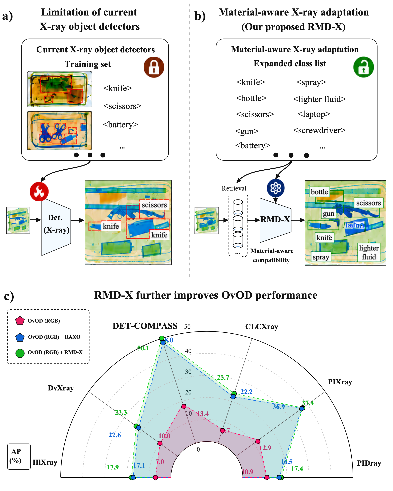
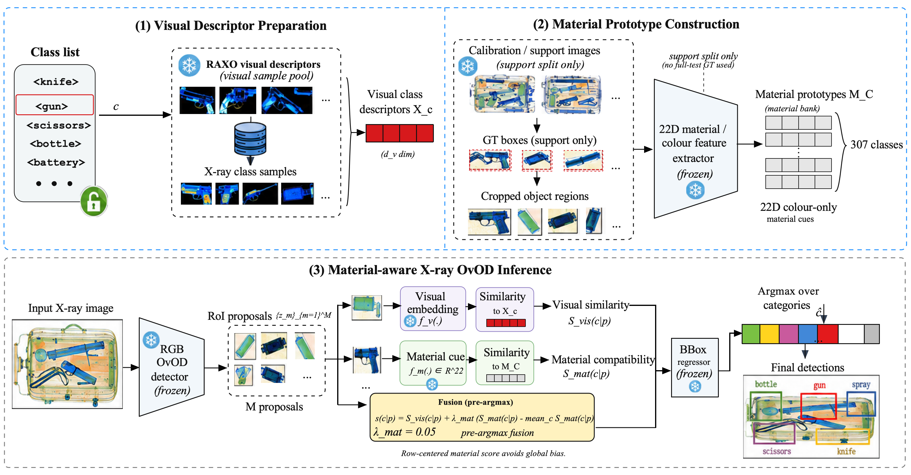
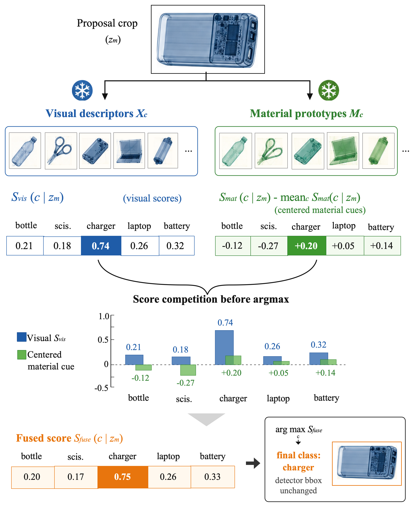
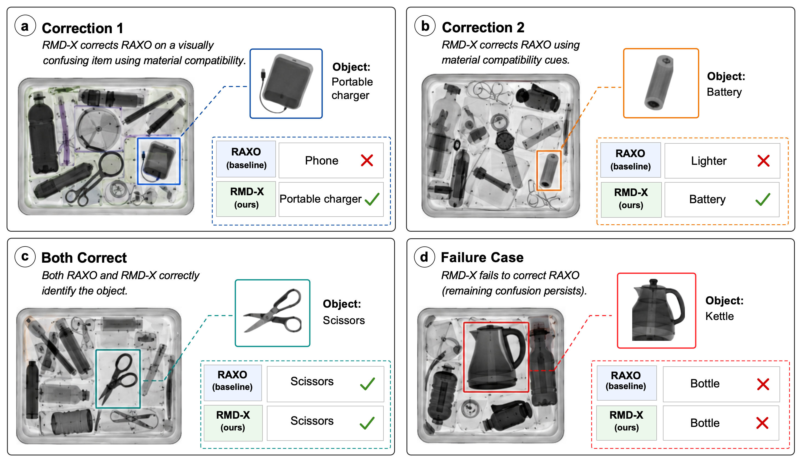
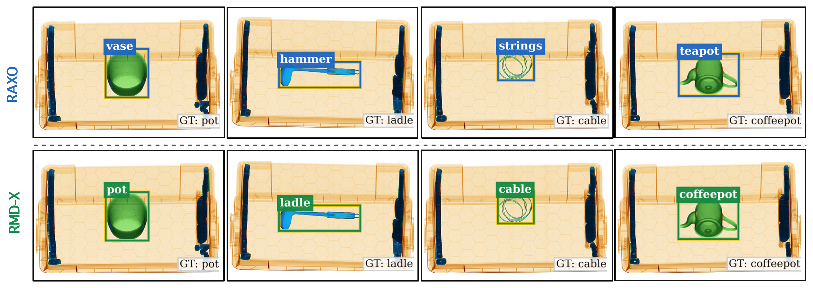

# RMD-X: Material-guided Soft Decision Fusion for X-ray OvOD

This repository contains the code release for **RMD-X**, a material-guided
pre-argmax soft fusion module for RAXO-style open-vocabulary X-ray object
detection.

RMD-X is designed as a lightweight refinement layer on top of a reproduced
RAXO pipeline. It keeps detector proposals and bounding boxes unchanged, and
only refines the category-score competition before the final class argmax.



## What Is Included

```text
RMD-X/
├── raxo/                    # RAXO runtime files required by the reproduced pipeline
├── rmdx/                    # RMD-X modules and exploratory variants
├── scripts_rmdx/            # Reproduction, cache, ablation, and audit scripts
├── configs/                 # Example local path configuration
├── docs/                    # Data/resource contracts and reproduction notes
├── assets/figures/          # Lightweight paper figures for repository documentation
├── outputs_rmdx/            # Empty placeholder; generated outputs are ignored
├── run_method_database_branch_v2.sh
├── run_method_web_branch_v2.sh
├── requirements.txt
└── README.md
```

This release intentionally does **not** include datasets, large model weights,
precomputed DINO/SAM proposal caches, experiment logs, or paper drafting files.

## Method Overview

RMD-X adds a support-derived material compatibility term to the RAXO visual
descriptor decision rule:

```text
S_fuse(c | p) = S_visual(c | p) + lambda_material * centered(S_material(c | p))
```

The final paper method is the fixed colour-only RMD-X pre-argmax fusion:

```text
mode = material_preargmax
lambda_material = 0.05
lambda_reliability = 0.0
```

For DET-COMPASS + GroundingDINO, the locked result is:

```text
RAXO baseline:  AP / AP50 / AP75 = 0.480 / 0.544 / 0.488
RMD-X fixed:    AP / AP50 / AP75 = 0.501 / 0.561 / 0.515
```

The core implementation is in:

- `rmdx/cache_builder.py`
- `rmdx/cache_fusion.py`
- `rmdx/material.py`
- `rmdx/preargmax_fusion.py`
- `scripts_rmdx/15_build_preargmax_cache_full.py`
- `scripts_rmdx/16_run_cache_fusion_grid.py`
- `scripts_rmdx/17_validate_cache_reproduction.py`

## Main Figures

Pipeline overview:



Pre-argmax material-aware fusion:



Qualitative examples:



Proposal consistency examples:



## Required External Resources

The following resources must be prepared locally before running the full
pipeline. They are intentionally excluded from this GitHub repository.

### Datasets

The paper uses six X-ray security datasets:

| Dataset | Expected annotation | Expected image directory | Main use |
|---|---|---|---|
| DET-COMPASS | `DET-COMPASS/annotations/full_test.json` | `DET-COMPASS/test/` | Main benchmark |
| PIXray | `PIXray/annotations/full_test.json` | `PIXray/test/` | Multi-dataset evaluation |
| PIDray / pidray | `pidray/annotations/full_test.json` | `pidray/test/` | Exploratory / multi-dataset evaluation |
| CLCXray | `CLCXray/annotations/full_test.json` | `CLCXray/test/` | Dataset-specific material evidence |
| HiXray | `HiXray/annotations/full_test.json` | `HiXray/test/` | Negative diagnostic evidence |
| DvXray | `DvXray/annotations/full_test.json` | `DvXray/test/` | Multi-dataset evaluation |

Expected root:

```text
/datasets/xray-datasets/
├── DET-COMPASS/
├── PIXray/
├── pidray/
├── CLCXray/
├── HiXray/
└── DvXray/
```

### Model and Proposal Resources

Expected root:

```text
/models/ICCV25_experimentation/
├── known_prototypes_sam2.pt
└── initial_detections/
    ├── groundingDINO/
    ├── VLDet/
    └── CoDet/
```

For the main DET-COMPASS + GroundingDINO experiment:

```text
/models/ICCV25_experimentation/known_prototypes_sam2.pt
/models/ICCV25_experimentation/initial_detections/groundingDINO/coco_results.bbox_DET-COMPASS_with_masks.json
/datasets/xray-datasets/DET-COMPASS/annotations/full_test.json
/datasets/xray-datasets/DET-COMPASS/test/
```

The repository also contains scripts for multi-detector and multi-dataset
audits. Detic is excluded from the DET-COMPASS main multi-detector table because
official DET-COMPASS Detic proposals were not available in the authors'
resource package.

See `docs/DATA_AND_RESOURCE_CONTRACT.md` and
`docs/DATASETS_AND_RESOURCES.md` for the full path contract.

## Environment

The original experiments were run in a Docker environment with CUDA-capable
GPUs. The common mount layout is:

```text
/path/to/RMD-X                           -> /workspace/RAXO
/path/to/models/ICCV25_experimentation   -> /models/ICCV25_experimentation
/path/to/datasets/xray-datasets          -> /datasets/xray-datasets
```

Copy and edit the example configuration:

```bash
cp configs/paths.example.env configs/paths.env
```

Install Python dependencies in your chosen environment:

```bash
python3 -m pip install -r requirements.txt
```

Some original RAXO stages require external runtime assets such as DINOv2, SAM2,
and detector checkpoints. The cache-based RMD-X reproduction assumes the
corresponding RAXO proposal / with-mask resources have already been prepared.

## Typical DET-COMPASS Reproduction Flow

```bash
# 1. Validate code/data contracts.
python3 scripts_rmdx/03_check_rmdx_contracts.py

# 2. Build or validate the support-derived colour material bank.
python3 scripts_rmdx/06_build_material_colour_bank.py

# 3. Build the RMD-X pre-argmax cache.
python3 scripts_rmdx/15_build_preargmax_cache_full.py

# 4. Run the fixed material pre-argmax fusion grid.
python3 scripts_rmdx/16_run_cache_fusion_grid.py

# 5. Validate locked cache reproduction.
python3 scripts_rmdx/17_validate_cache_reproduction.py
python3 scripts_rmdx/19_run_cache_regression_test.py
```

Generated outputs are written under `outputs_rmdx/` and are ignored by Git by
default.

## Leakage and Reproducibility Policy

- The main material bank should be constructed from non-test support/prototype
  data.
- Do not use `full_test.json` ground-truth boxes to construct the main material
  bank.
- Test images may be used only as inference-time inputs for detector proposals.
- Large generated caches, checkpoints, datasets, and logs should remain outside
  Git.

## GitHub Upload Boundary

Upload this folder as the repository root. Do **not** upload:

- dataset archives or extracted datasets;
- `/data`, `/datasets`, or `/models`;
- DINOv2 / SAM2 / detector checkpoints;
- `outputs_rmdx/cache*`;
- `outputs_rmdx/logs`;
- paper LaTeX drafting folders;
- `__pycache__`;
- `.pt`, `.pth`, `.pkl`, `.parquet`, `.zip`, `.tar`, `.7z`, `.rar` files unless
  you intentionally release a tiny example.

## Citation

Please cite the accompanying paper if this code is useful for your research.

