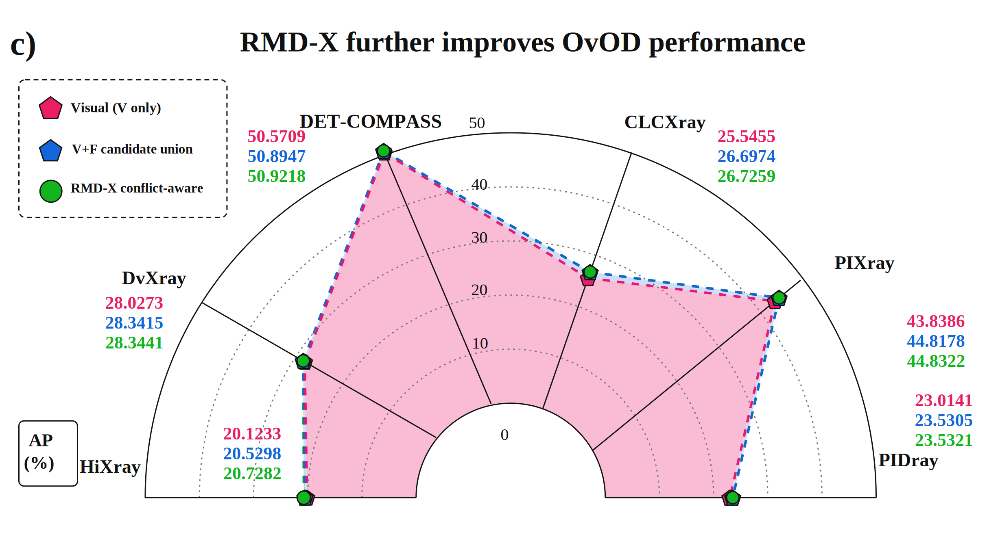

# RMD-X: Conflict-Aware Appearance Fusion for X-Ray Object Detection

Code and recorded evidence for **Conflict-Aware Appearance Fusion for Open-Vocabulary X-Ray Object Detection**. This release adds the source-trained quality anchor, supported-conflict pair projection, uncertainty analysis, component ablations and full-image runtime protocols to the earlier native candidate-fusion code.

**Current entry points are in [`reproduction/`](reproduction/README.md).** The original `rmdx/`, `raxo/` and numbered `scripts_rmdx/` remain the legacy native-stage implementation and historical exploration; they are not the complete selected conflict-aware method. The previous README and guides are preserved under [`docs/legacy/`](docs/legacy/).

## Method

RMD-X retains two complementary native candidate streams: visual-reference candidates **V** and visual-plus-appearance candidates **F**. A 22-dimensional descriptor of the rendered region captures colour/intensity, edges and box geometry; category-aligned support comparisons augment the visual prototype competition. The union retains only native-surviving branches.

A source-trained quality anchor fixes one branch, category and box per proposal. A learned class-conditioned residual then acts only on valid disagreements with genuine support for both retained categories. Its signed pair projection `(-D, +D)` has zero sum in **logit corrections**. It refines confidence and subsequent ranking, while the selected category and detector box stay fixed. Inactive entries preserve the original anchor quality before the inherited suppression step. `D` may have either sign.

Detector and image-encoder weights stay frozen; the downstream quality/residual heads are fitted on the recorded source data. This is not a training-free method or a measurement of physical material composition. Subtracting a common material-score mean across native prototype columns is algebraically redundant and is not claimed as an innovation.

## Recorded results

AP is in percent. Visual candidates and candidate union use the same frozen shared scorer; the last column isolates the selected conflict-aware ranking increment over that union. The native appearance-only (**F-only**) condition is a different comparison and is not shown in this table.

| Dataset | Visual candidates | Candidate union | RMD-X selected | Ranking gain (pp) |
|---|---:|---:|---:|---:|
| DET-COMPASS | 50.5709 | 50.8947 | 50.9218 | +0.027076 |
| CLCXray | 25.5455 | 26.6974 | 26.7259 | +0.028442 |
| PIXray | 43.8386 | 44.8178 | 44.8322 | +0.014383 |
| PIDray | 23.0141 | 23.5305 | 23.5321 | +0.001599 |
| DvXray | 28.0273 | 28.3415 | 28.3441 | +0.002582 |
| HiXray | 20.1233 | 20.5298 | 20.7282 | +0.198433 |

Candidate fusion increases mean AP by **0.6153 percentage points** over V-only under the shared scorer. The selected conflict-aware stage adds a further **0.045419 points** over the union. Its six-dataset mean has a conditional paired-image 95% interval of **[0.029460, 0.073577] points** for the fixed recorded datasets and predictions. Five individual ranking gains are below 0.03 points; the CLCXray and DvXray intervals include zero. These point estimates do not establish significance on every dataset or superiority over every alternative endpoint.

[Full-precision result table](results/current_six_dataset_AP.csv) · [Evidence, intervals and ablations](reproduction/README.md)



The original half-annular chart geometry and styles are retained. Near-overlapping blue/green curves reflect the actual small differences; points have not been separated or the scale changed to amplify gains. This chart replaces the old teaser as the current numerical summary. The older X-ray illustrations in `assets/figures/` are retained only as historical assets, not current experimental evidence.

## Inspect the release

```bash
git clone https://github.com/YXY-PRIV/RMD-X.git
cd RMD-X
python3 reproduction/inspect_release.py
```

Inspection does not train a model, run native AP evaluation, bootstrap or launch GPU workers. See [`reproduction/README.md`](reproduction/README.md) for the portable mathematical core, small checks, recorded source entry points and external resource configuration. The recorded scripts retain their original source bytes and protocol identities; a separately identified portable layer avoids the private filesystem layout. No fresh end-to-end scientific rerun is claimed for this publication update.

## Source and evidence layout

- `reproduction/`: current algorithm sources, compact fitted states, recorded protocols and result/evidence summaries; see its index for precise paths and execution boundaries.
- `results/current_six_dataset_AP.csv`: full-precision AP values used above and in the accompanying manuscript.
- `assets/results/`: the numerical chart, without any provider radiograph pixels.
- `rmdx/`, `raxo/`, `scripts_rmdx/`: preserved native-stage and legacy code.
- `docs/`: current reproduction and resource boundaries; `docs/legacy/` preserves older instructions.

## Reproduction boundaries

- Provider radiographs/annotations, large feature and prediction caches, and upstream detector/DINO/SAM checkpoints are external resources. Access, redistribution and third-party notices remain subject to their providers. They are not added in this update.
- The quality heads use recorded source supervision, including CLCXray, PIDray and HiXray; these conditions are not presented as unseen-domain evaluation. Historical test exposure and the five incompletely reconstructable support-class origins remain limitations.
- Confidence intervals condition on fixed recorded cohorts and predictions; they do not include training or support-sampling variation. Native negative transfer and unfavourable component ablations remain in the evidence rather than being discarded.
- Cached downstream timings are distinct from the measured raw-image deployment workload. The raw-image pipeline's upstream identity is not authenticated to the historical cached-AP inputs, and the small measured timing difference is not claimed as a speedup or a certified joint speed/accuracy operating point.

This release provides code, compact author-fitted downstream states and recorded numerical evidence for the manuscript named above. Provider data and model access remain separate. Use a pinned commit when citing the software and its recorded results.
